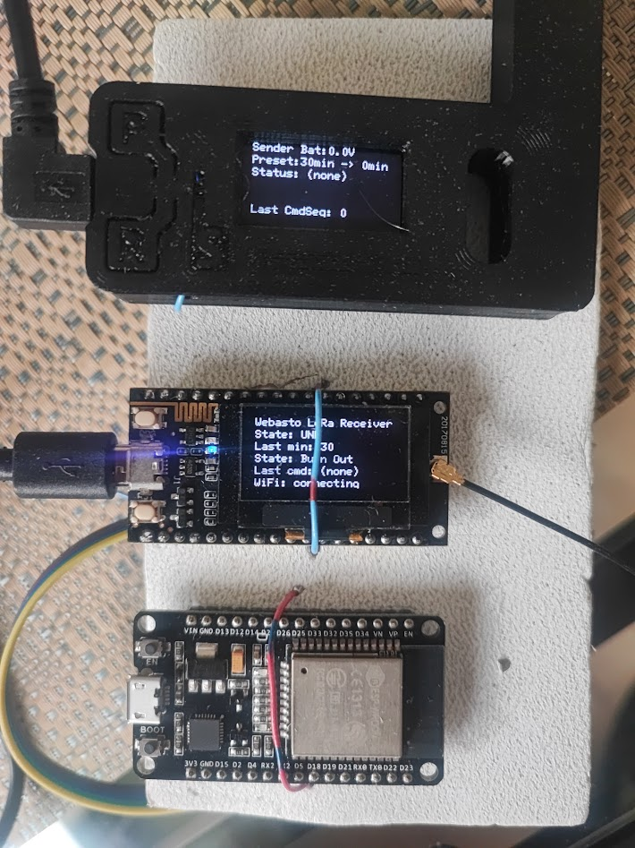
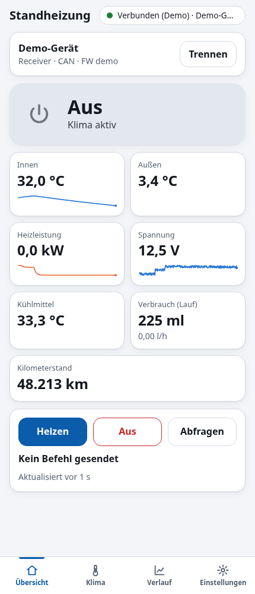

# Webasto ThermoTop C LoRa Remote (TTGO LoRa32 SX1276 OLED)



> **CAN instead of W-BUS (in progress):** on the VW T5.2 the factory heater can be switched
> over CAN (0x5D3) and its status read (0x3E5). Findings, frame layouts and test log:
> [docs/can-t5-webasto.md](docs/can-t5-webasto.md). Sniffer firmware: `src/cansniffer/`,
> capture tool for Claude Code: `mcp-can-capture/`.

Two TTGO LoRa32 SX1276 OLED boards:

- **Sender**: sends `start`, `stop`, `run <minutes>` over LoRa; shows receiver/heater status on OLED.
- **Receiver**: receives commands, controls the heater over **CAN** (default, T5.2) or **W‑BUS**, reports status back over LoRa; shows state on OLED.

## Phase D: CAN transport, climate control, BLE and PWA

Branch `worktree-phase-d`. Protocol is **v5 (magic 0x35)**: flash sender and receiver together.

- **Heater transport**: CAN (TWAI, 100 kbit/s, SN65HVD230) is the default. `pio run -e receiver_wbus` builds the former W-BUS transport (`HEATER_TRANSPORT_WBUS=1`). Ventilation is not implemented over CAN and is ignored (result `Unsupported`).
- **Listen-only first test**: add `-D CAN_ALLOW_TX=0` to the receiver build flags. Nothing is transmitted then.
- **Wiring (receiver)**: CAN TX=GPIO17, RX=GPIO25 (10 kΩ pull-up from CTX to 3.3 V recommended). DS18B20 interior sensor on GPIO32 with a 4.7 kΩ pull-up to 3.3 V. In the W-BUS build GPIO17/25 are the W-BUS pins again.
- **Status values** (LoRa, MQTT, BLE): heater phase, heating power (W), fuel rate (l/h), fuel used (ml), heater coolant, interior (DS18B20), outside, supply voltage, odometer, error code, bus awake, ignition, climate state and target. MQTT additionally publishes one JSON state topic `webasto/receiver/state` and Home Assistant discovery entities for all values.
- **Climate control**: target 10..24 °C in whole degrees, session duration up to 8 h. It only starts the heater when the interior temperature falls below the target (it never switches off), minimum pause 2 min, back-off after failed starts, low-voltage lockout. The heater run time is chosen by the roof unit (30 min after a CAN start); the controller restarts the heater when needed during the session.
- **LoRa airtime**: the receiver only transmits while a sender was active within the last 30 min (`LORA_SENDER_ACTIVE_MS`). Intervals: 15 s heating, 30 s climate only, 120 s idle. The sender sends a keep-alive query every 10 min while the user is looking at it.
- **Receiver OLED**: while the heater runs it shows full-screen pages in large font, switching every second.
- **Non-blocking design**: one FreeRTOS task per hardware (CAN, LoRa, control, network, UI, BLE), communication through queues and snapshot buffers, no `delay()` in the application code. Deep sleep is not supported in this phase.
- **BLE and PWA**: the receiver exposes a NimBLE GATT service (status, command, result; bonding with passkey, pairing window 120 s after "BLE koppeln" in the menu). The Android PWA in `pwa/` shows status, history charts (temperatures, power, voltage, fuel), a climate dial and the control buttons. Start it locally with `python3 -m http.server --directory pwa 8000` (Web Bluetooth needs HTTPS or localhost); a demo mode works without a device. Tests: `node --test pwa/test/`.

  BLE naming and auto-connect: each unit advertises a unique, role-aware name built from the last two bytes of its Bluetooth MAC: `Webasto-RX-XXXX` (receiver) and `Webasto-TX-XXXX` (sender), XXXX in uppercase hex (helper `lib/webasto_core/ble_name.h`). "Verbinden" opens the browser's chooser, which lists every unit with the service; the unique names tell receiver and sender apart. The first pairing needs the chooser once; the PWA remembers the chosen unit (to switch: Trennen, then Verbinden). Afterwards the PWA reconnects by itself without the chooser where the browser supports `navigator.bluetooth.getDevices()` and `watchAdvertisements()` (Chrome on Android, possibly behind the flag `enable-web-bluetooth-new-permissions-backend`); otherwise the button stays. It waits up to 8 s for the device's advertisement, only while the page is visible, and retries on the next visibility change or with "Erneut suchen". If no advertisement arrives within 8 s (Chrome on Linux delivers none for bonded devices), it tries one direct connect.
- **Tests**: `tools/run_native_tests.sh` runs the host unit tests (CAN codec and FSM, climate controller, codecs, send policy).
- **Sender menu**: Heizen, Aus, Klima an, Klima aus, Abfrage, and with BLE also BLE koppeln (pairing window 120 s) and Bindungen loeschen.
- **Sender over BLE** (`-D ENABLE_BLE=1` in `[env:sender]`, remove it to build without BLE): the sender uses the same GATT profile as the receiver, with role = sender and transport = none in the info characteristic (no heater transport, it relays over LoRa). In the PWA pick `Webasto-TX-XXXX` in the chooser (the receiver is `Webasto-RX-XXXX`). The name is printed once in the serial log at start. Pairing, bonding and passkey (`-D BLE_PASSKEY=...`, default passkey is flagged in the log) work as on the receiver.
  - Status: the last status the sender received over LoRa, with the sender's own RSSI/SNR and the age of that status in the link-age field. Before the first LoRa status, all values are unknown and the stale flag is set. The stale flag is also set when the status is older than 3 receiver status intervals (30 s).
  - Commands: Heat becomes `Start` (with the last run time of the sender), Stop `Stop`, Climate on `ClimateSet` (10..24 C, 10..480 min), Climate off `ClimateOff`, Query `QueryStatus`; each is sent over LoRa with the existing retry/ACK job. Result characteristic: queued, sent, acked, then done or failed (NotAdopted, Unsupported, NoBus and Timeout come from the receiver or the job timeout). While a job runs, further commands get Busy; commands without a LoRa equivalent get Unsupported.
  - BLE runs in its own task (`bleTask`, core 0); it shares data with the main loop only through a snapshot buffer and two queues (`src/sender/sender_ble.h`), so LoRa timing is unaffected. BLE activity counts as user activity for the keep-alive. Host logic: `lib/webasto_core/sender_ble_map.h`.


### PWA screenshot



The overview tab of the Standheizung PWA, taken in demo mode (`?demo=1`), so all values are
sample data and not measurements. From top to bottom:

- **Header and device card:** connection state and the name of the connected unit
  (`Webasto-RX-XXXX` or `Webasto-TX-XXXX`), with role and transport, and a button to disconnect.
- **State tile:** heater state (off, heating, ventilating, run-on) and whether the climate
  control is active.
- **Value tiles with sparklines:** interior and outside temperature, heating power in kW,
  board voltage, coolant temperature, fuel used in the current run (ml) with the rate in l/h,
  and the odometer.
- **Command card:** Heizen, Aus and Abfragen, the result of the last command and the age of the
  last status.
- **Tab bar:** Übersicht, Klima (target temperature dial), Verlauf (history charts) and
  Einstellungen (theme, clock, demo mode).

## What’s implemented

- LoRa P2P link using `sandeepmistry/LoRa`
- **AES-128-CTR encryption** on all LoRa packets (hardware-accelerated via mbedTLS)
- OLED UI using `U8g2` (SSD1306 I2C)
- **Interactive GPIO0 menu system** (boot button controls START/STOP/RUN/QUERY commands)
- **Power-optimized sleep modes** with conditional W-BUS polling
- W‑BUS framing for:
  - `0x21` **Parking heater on** (1 byte: minutes)
  - `0x10` **Shutdown**
  - `0x50` index `0x07` **Operating state read**
  - `0x44` **Keep-alive** (maintains active session)
- **MQTT integration** (optional, via `-DENABLE_MQTT_CONTROL` build flag):
  - HomeAssistant autodiscovery
  - Command topics: start, stop, run_minutes, query
  - Status sensors: temperature, voltage, power, state, flame detection
  - OTA firmware updates

The W‑BUS packet structure and commands above come from `webasto_wbus.txt` in H4jen/webasto.

## Hardware notes (W‑BUS is NOT TTL)

W‑BUS is a **single-wire 12V K‑line style bus** (open collector) using **2400 baud, 8E1 (even parity)**.

You must use a proper interface between the ESP32 and W‑BUS, for example:

- a dedicated transceiver (e.g. NXP `MC33660` / `MC33290`), or
- an open‑collector transistor level-shifter circuit.

This project talks to that interface via ESP32 `Serial2` using the pins in `include/project_config.h`.

## Pinout defaults

Defaults are set for **TTGO LoRa32-OLED V1.0**:

- LoRa: `SCK=5`, `MISO=19`, `MOSI=27`, `CS=18`, `RST=14`, `DIO0=26`
- OLED I2C: `SDA=4`, `SCL=15`, `RST=16`

If your board revision differs, adjust `include/project_config.h`.

## Security: AES-128-CTR Encryption

All LoRa packets are encrypted end-to-end using **AES-128-CTR** with hardware acceleration:

### Implementation Details
- **Algorithm**: AES-128-CTR (stream cipher, no padding overhead)
- **Hardware Acceleration**: mbedTLS with ESP32's AES engine
- **Nonce**: Implicit, derived from packet `seq + src + dst` (no transmission overhead)
- **Packet Size**: 60 bytes total (no increase vs. plaintext due to implicit nonce design)
- **Pre-Shared Key**: 16-byte PSK stored in firmware (default: `"WbastoLora2026"`)

### Security Properties
- ✅ **Confidentiality**: Payload encrypted with AES-128-CTR (industry-standard)
- ✅ **Integrity**: CRC-16 validates transmission (detects bit errors)
- ✅ **Replay Prevention**: Sequence counter in nonce prevents identical packet replay
- ⚠️ **Authentication**: Not cryptographically signed (relies on PSK + CRC)

### Changing the Pre-Shared Key
Edit `lib/common/protocol.h`:
```cpp
static constexpr uint8_t kDefaultPSK[16] = {
  0x57, 0x65, 0x62, 0x61, 0x73, 0x74, 0x6F, 0x4C,  // "WbastoL"
  0x6F, 0x52, 0x61, 0x32, 0x30, 0x32, 0x36, 0x00   // "oRa2026"
};
```
Both sender and receiver **must use the same PSK** or communication will fail.

## Build & flash

Open this folder in VS Code with PlatformIO installed.

- Build/Upload sender: select environment `sender`
- Build/Upload receiver: select environment `receiver`

Or CLI:

- `pio run -e sender -t upload`
- `pio run -e receiver -t upload`

## Bench W-BUS simulator (ESP32 Dev Module)

This repo includes a third firmware target:

- **simulator**: an ESP32 Dev Module that emulates a ThermoTop-like W-BUS device over **TTL UART**.

This is intended for bench testing the **receiver** without a real heater.

Wiring (TTL UART, cross TX/RX + common GND):

- TTGO receiver `WBUS_TX_PIN` (GPIO17) -> simulator `WBUS_RX_PIN` (GPIO16)
- simulator `WBUS_TX_PIN` (GPIO17) -> TTGO receiver `WBUS_RX_PIN` (GPIO34)

Build/upload:

- `pio run -e simulator -t upload`

The simulator responds to the receivers existing requests:

- `0x21` start (minutes)
- `0x10` stop
- `0x50` index pages (including `0x07` operating state)
- `0x50 0x30 ...` multi-status snapshot

## Configure LoRa frequency

Set your region’s band in `platformio.ini`:

- `-D LORA_FREQUENCY_HZ=433E6` or `868E6` or `915E6`

Both sender and receiver must match.

## Sender usage

Open Serial Monitor at `115200` and type:

- `run 30`
- `start`
- `stop`

`start` uses the last `run <minutes>` value (defaults to `DEFAULT_RUN_MINUTES`).

### Range test (ping-pong)

Measures the LoRa range without touching the heater. Start it with the menu item **Ping-Pong**
(long press again to stop) or on the serial console with `ping [n]` (`n` pings, none = until
`pingstop`).

- The sender transmits a ping (8 bytes on air). The receiver answers at once with a pong that
  carries the RSSI and SNR it measured for that ping, so one test gives **both directions**:
  uplink (receiver heard the sender) and downlink (sender heard the receiver), plus the round
  trip time.
- The interval follows from the radio profile: at least 11 times the longest airtime (10 % duty
  cycle in the 433 MHz band), and long enough for the pong to arrive. At SF11 that is about 7.5 s
  per ping.
- The OLED shows pings sent, answered and lost, the loss in percent, and the last RSSI/SNR of
  both directions. The serial log has one line per ping, and `pingstop` (or the menu) prints min,
  average and max of RSSI, SNR and round trip time.
- A ping does not open the receiver's sender-active window and never reaches the heater. A heater
  command ends a running test.
- The receiver needs the same firmware version (new message types Ping and Pong); the receiver
  menu has no entry for it.
- Pings and pongs are encrypted like all other packets.

## Receiver status polling

Receiver polls W‑BUS operating state every ~2 seconds (command `0x50` index `0x07`) and sends status back over LoRa.

## Power Management & Sleep Modes

The receiver implements aggressive power management for battery operation.

### Normal Operation (DISABLE_SLEEP=0)

**Startup Sequence:**
1. Initialize LoRa, W-BUS, WiFi/MQTT concurrently
2. WiFi attempts connection for up to 10s (non-blocking)
3. LoRa RX active immediately regardless of WiFi state
4. System ready within 2-3s

**Heater OFF (Idle Mode):**
- **Sleep cycle**: Wake every 4s, listen for 400ms LoRa commands, then deep sleep
- OLED powered off to save energy
- WiFi/MQTT connection attempts continue in background (non-blocking)
- W-BUS polling minimized to reduce wake time
- **Power**: ~10mA average (vs ~150mA when fully awake)

**Command Received:**
- Any command (LoRa, MQTT, or button) wakes receiver fully
- If command starts heater → transition to Running mode
- If heater stays OFF → stay awake for RX window, then return to sleep

**Heater RUNNING:**
- Stay fully awake (no deep sleep)
- OLED stays on for real-time status display
- LoRa RX continuous for low-latency updates
- WiFi/MQTT maintain connection for monitoring
- W-BUS polled every 2s
- **Power**: ~150-200mA

**Heater Turns OFF → Extended Wake:**
- **Stay awake for 60s after heater shuts down**
- Allows final status updates to reach sender/MQTT
- Ensures clean shutdown communication
- W-BUS continues polling during extended wake for final status
- After 60s: return to sleep cycle if no new commands

**W-BUS Polling & Power Management:**
- **CRITICAL**: W-BUS polling wakes the Webasto heater, drawing unnecessary power!
- **Solution**: Only poll W-BUS when absolutely necessary:
  - ✅ Heater is RUNNING (continuous monitoring required)
  - ✅ In extended wake period (final status updates)
  - ✅ Explicit `QueryStatus` command received (on-demand polling)
  - ❌ **NOT during idle wake windows** (would wake Webasto unnecessarily)

**QueryStatus Command:**
- **Purpose**: Poll W-BUS for current status without starting the heater
- **Use case**: Check heater temperature/voltage while idle without continuous wake
- **Available from**:
  - **Sender (LoRa)**: Press button → navigate to "STATUS?" → long press
  - **MQTT**: `mosquitto_pub -h <broker> -t webasto/receiver/query -m ""`
  - **Receiver button**: Navigate to "STATUS?" in menu
- **Behavior**: Triggers single W-BUS poll (~250ms) → reports status → returns to sleep
- **Power impact**: ~250ms W-BUS wake vs continuous 2s polling

**Testing Mode (DISABLE_SLEEP=1):**
- Fully awake at all times
- W-BUS polls continuously every 2s
- Useful for serial debugging and development
- Set in `platformio.ini`: `-D DISABLE_SLEEP=1`

### Configuration Tuning

Edit `include/project_config.h`:
```cpp
#define RX_IDLE_LISTEN_WINDOW_MS 400   // LoRa RX window when waking
#define RX_IDLE_SLEEP_MS 4000          // Sleep interval (heater OFF)
#define RX_OFF_EXTENDED_WAKE_MS 60000  // Stay awake 60s after heater stops
```

**Trade-offs:**
- Shorter `RX_IDLE_SLEEP_MS` = faster command response, higher power draw
- Longer `RX_IDLE_LISTEN_WINDOW_MS` = higher command catch rate, more wake power
- Extended wake ensures WiFi has time to publish final status before sleeping

## Full Round-Trip Test Results

### ✅ System Configuration
- **LoRa Frequency**: 433 MHz (TTGO boards are 433 MHz antenna variants)
- **LoRa Parameters**: BW=125kHz, SF=7, CR=4/5, Sync=0x12
- **LoRa Security**: AES-128-CTR encryption (hardware-accelerated)
- **W-BUS Baud**: 2400, 8E1 (even parity)
- **Hardware**: 2x TTGO LoRa32-OLED V1.0 + 1x ESP32 Dev Module simulator
- **Wiring**: Receiver TX(GPIO17) ↔ Simulator RX(GPIO16), Receiver RX(GPIO25) ↔ Simulator TX(GPIO17), common GND

### ✅ Verified Functionality

#### **Sender → Receiver (LoRa Command Link)**
- Sender transmits 44-byte **encrypted** command packets over LoRa (433 MHz, 6 dBm TX power)
- Encryption: AES-128-CTR with implicit nonce (no transmission overhead)
- RSSI: -32 to -33 dBm (excellent signal quality)
- Commands tested:
  - `RUN <minutes>`: Start heater for N minutes
  - `STOP`: Shutdown heater
  - `START`: Start with default duration
- ACK mechanism: Receiver echoes `lastCmdSeq` in status, sender confirms receipt
- **Result**: All commands successfully received, decrypted, and acknowledged

#### **Receiver → Simulator (W-BUS Control)**
- Receiver forwards LoRa commands to simulator via W-BUS (2400 baud TTL UART)
- Command frames properly formatted with:
  - Header: 0xF4 (controller→heater)
  - Command byte (0x21=start, 0x10=stop)
  - Minutes parameter
  - XOR checksum validation
- **Result**: Simulator correctly parses all commands and transitions state

#### **Simulator State Management**
- Simulator maintains realistic heater state machine:
  - **OFF** → STARTING (on 0x21) → RUNNING (after 15s) → COOLING (on 0x10) → OFF
  - Temperature: Smoothly ramps from 20°C (idle) → 75°C (running)
  - Heater power: 0 → 250 (starting) → 700 (running) → 100 (cooling) → 0
  - Glow plug: 0 → 80% (starting) → 10% (running)
  - Combustion fan: 0 → 1800 RPM (starting) → 4200 RPM (running)
  - Voltage: 12400mV (idle) → 12150mV (load)

#### **Simulator → Receiver (W-BUS Status)**
- Simulator responds to all W-BUS status request pages:
  - `0x05`: Temperature, voltage, flame, heater power
  - `0x0F`: Glow plug, fuel pump, fan percentages
  - `0x02`, `0x03`: Status flags (STARTING=0x30, RUNNING=0x06, OFF=0x00, COOLING=0x04)
  - `0x06`: Operating counters
  - `0x07`: Operating state code
  - `0x30`: Multi-status TLV snapshot (29 status fields)
- Response frames properly formatted with:
  - Header: 0x4F (heater→controller)
  - Command byte: 0xD0 (0x50|0x80 ACK)
  - Index/subcommand + data payload
  - XOR checksum validation
- **Result**: All status pages respond within 250ms timeout

#### **Receiver → Sender (LoRa Status Link)**
- Receiver transmits 44-byte **encrypted** status packets every 2 seconds
- Encryption: AES-128-CTR with implicit nonce (hardware-accelerated via mbedTLS)
- Status payload includes:
  - Temperature: 20°C (idle) → 75°C (starting) → temperature readings during operation
  - Voltage: 12400mV → 12150mV (load)
  - Operating state: OFF/STARTING/RUNNING/COOLING
  - Glow plug, fuel pump, fan percentages
  - Flame detection
  - Heater power
  - lastCmdSeq (for ACK correlation)
- **Result**: Sender continuously receives, decrypts, and displays status updates

### ✅ Example Command Sequence
```
USER INPUT: "run 20" (sender serial)
├─ Sender: Encode START_20MIN command, seq=6
├─ [LoRa TX] Sender transmits 44 bytes at 433 MHz
├─ [LoRa RX] Receiver receives with RSSI=-33dBm
├─ Receiver: Decode command, forward to W-BUS
├─ [W-BUS] Receiver TX: 0xF4 0x03 0x21 0x14 <checksum>
├─ [W-BUS] Simulator RX: Parse frame, set state=STARTING
├─ [W-BUS] Simulator TX: 0x4F 0x03 0xA1 0x14 <checksum> (ACK)
├─ Receiver: Collect W-BUS status pages (0x05, 0x0F, 0x02, 0x03, 0x06)
├─ Status: tempC=75, hp_x10=250, glow=160, fan=36, flags=0x30 (STARTING)
├─ Receiver: Encode status payload, lastCmdSeq=6
├─ [LoRa TX] Receiver transmits 44 bytes
├─ [LoRa RX] Sender receives status
├─ Sender: Verify lastCmdSeq==6 → ACK confirmed!
└─ USER: "Sent RUN (20 min, ACKed)" + display status
```

### ✅ Performance Metrics
- **LoRa Command Latency**: <100ms (TX overhead)
- **W-BUS Response Time**: <250ms (status polling timeout)
- **Status Update Period**: 2 seconds (receiver poll cycle)
- **Packet Loss**: 0% (tested over 5+ minutes)
- **LoRa Link Quality**: Excellent RSSI (-32 to -33 dBm) over 5+ meter distance
- **Checksum Validation**: 100% pass rate on all frames

### ✅ Known Limitations & Notes
- Simulator uses synthetic state machine (not real heater physics)
- W-BUS UART is simulated over TTL (real W-BUS would use MC33660 transceiver)
- DISABLE_SLEEP build flag enabled for continuous testing (disable for battery operation)
- Keep-alive (0x44) and command renewal automatically handled by receiver
- GPIO16 (OLED_RST) conflicts with standard W-BUS RX pin; receiver uses GPIO25 instead

## QueryStatus Command

The `QueryStatus` command triggers an on-demand W-BUS status poll **without starting the heater**. This is essential for power management: during idle sleep cycles, the receiver does NOT poll W-BUS (to avoid waking the Webasto unnecessarily). QueryStatus enables explicit status checks when needed.

### Available via 3 interfaces:

1. **Button Menu** (sender or receiver):
   - Navigate to "STATUS?" item
   - Long-press (≥800ms) to activate
   - Single W-BUS poll → status update

2. **LoRa Command** (sender to receiver):
   - Sender transmits `CommandKind::QueryStatus` packet
   - Receiver polls W-BUS once
   - Status returned via LoRa

3. **MQTT** (HomeAssistant or direct publish):
   ```bash
   mosquitto_pub -h <broker> -t webasto/receiver/query -m ""
   ```
   - Receiver polls W-BUS once
   - Status published to MQTT topics

### Power Impact
- **Without QueryStatus**: Idle wake = 400ms LoRa RX only
- **With QueryStatus**: Single 250ms W-BUS transaction on-demand
- **Benefit**: Webasto stays asleep during idle cycles (no continuous polling)

### W-BUS Polling Behavior

The receiver conditionally polls W-BUS based on operational state:

| State | W-BUS Polling | Reason |
|-------|---------------|--------|
| **Heater RUNNING** | Every 2s | Continuous monitoring required |
| **Extended wake** (60s after OFF) | Every 2s | Final status updates |
| **Idle wake** (LoRa RX window) | ❌ OFF | Avoid waking Webasto |
| **Deep sleep** | ❌ OFF | Power save mode |
| **QueryStatus requested** | Once | On-demand status check |

This conditional polling prevents the receiver from waking the Webasto heater during normal idle operation, significantly reducing power consumption on both sides.

## Safety

You are controlling a fuel-burning heater. Validate wiring, fusing, and interlocks, and test safely.

